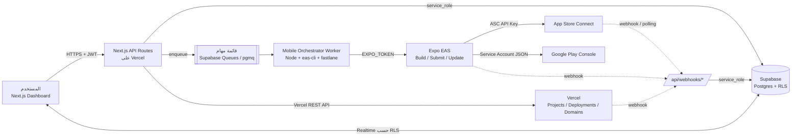
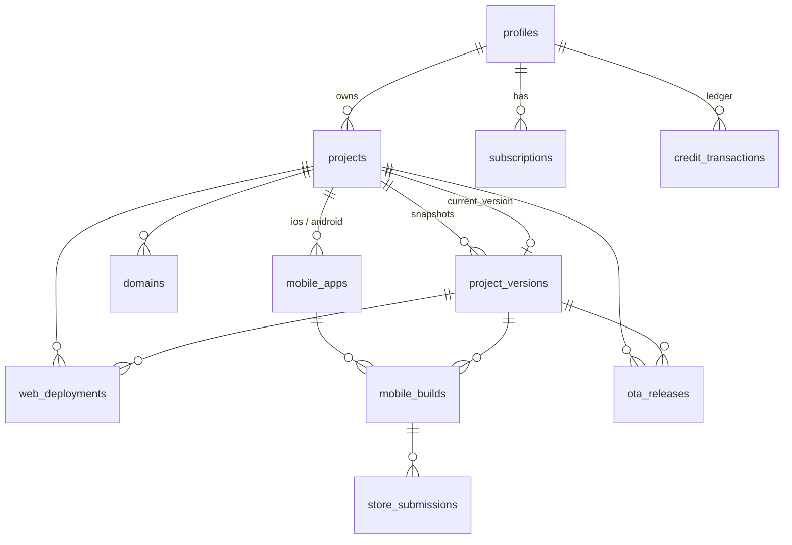
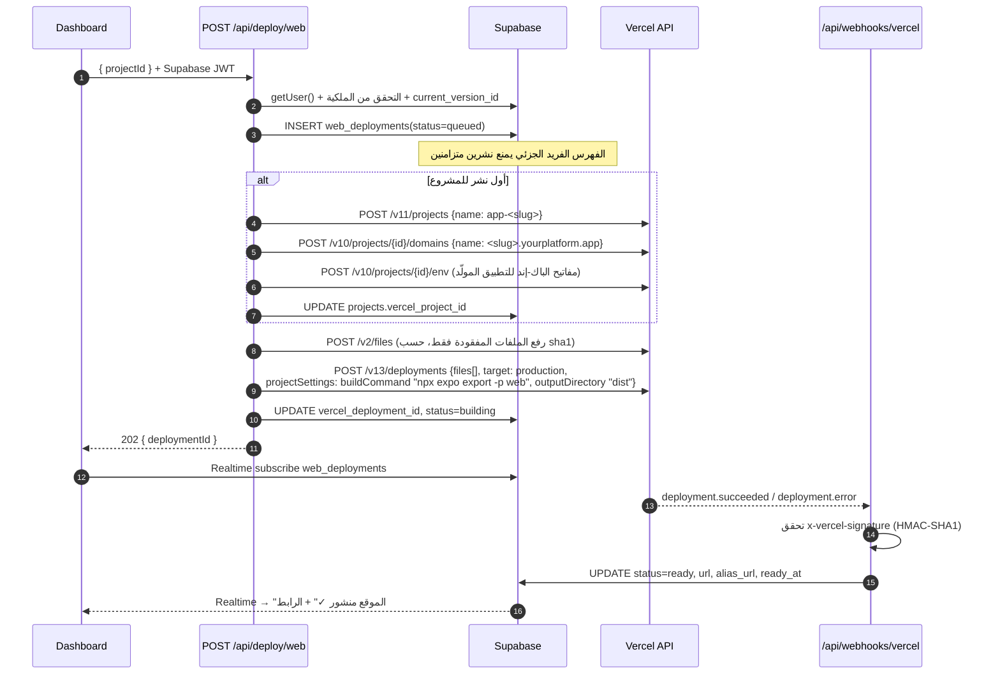
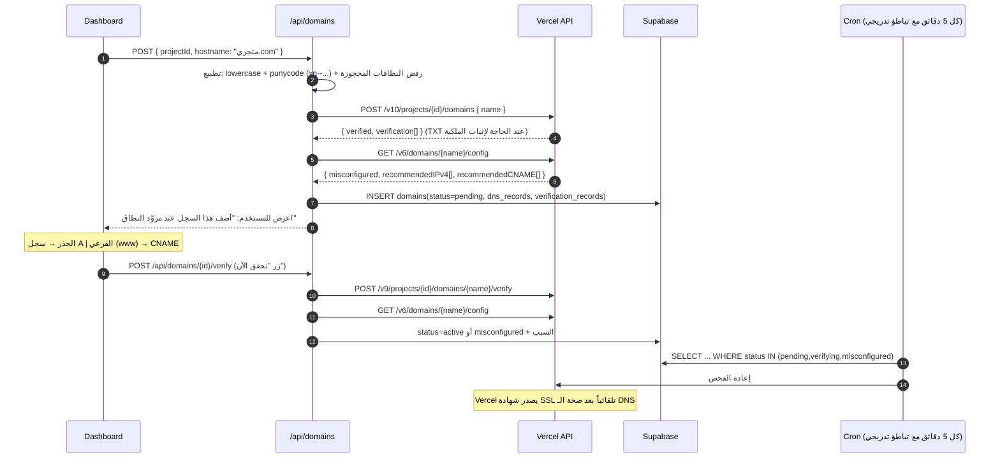
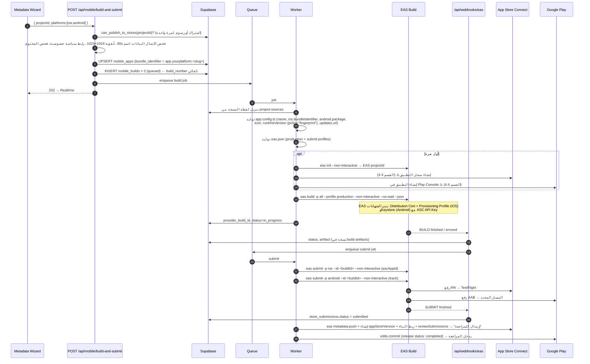
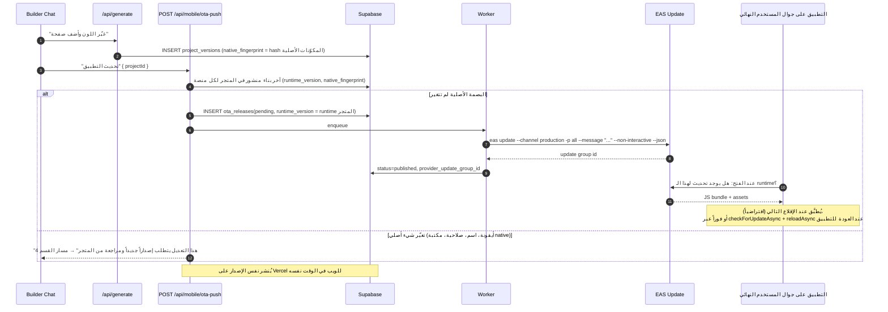
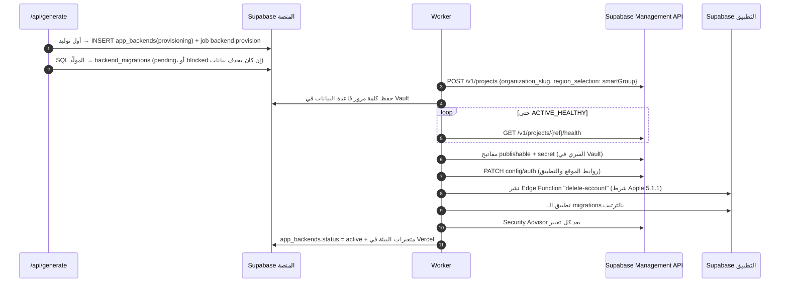

# البنية المعمارية للربط السحابي

> الإصدار 0.3، بتاريخ 21 نوفمبر 2026. تغطي الخطوات الأربع من خطة التنفيذ (القسم 10 لأكواد الباك-إند، والقسم 11 للواجهة): مخطط قاعدة البيانات، ومسار الطلب من ضغطة الزر إلى Vercel ثم EAS Build/Submit ثم EAS Update.
>
> **اقرأ القسم 7 (مخاطر سياسات المتاجر) قبل أي شيء آخر.** فيه قيود حقيقية من Apple وGoogle تمس النموذج التجاري نفسه، وليست تفاصيل تقنية فقط.

---

## 1. الصورة العامة



### قرارات أساسية

| القرار | الاختيار | السبب |
|---|---|---|
| إطار التطبيقات المولّدة | **Expo (React Native + expo-router + React Native Web)** | قاعدة كود واحدة للويب وiOS وAndroid، وEAS يغطي البناء والرفع والتحديث OTA ضمن منظومة واحدة. Capacitor + Capgo بديل مناسب إذا كانت التطبيقات المولّدة ويب أولاً (القسم 5.1). |
| تنفيذ العمليات الطويلة | **قائمة مهام + Worker منفصل** | البناء يستغرق من 10 إلى 30 دقيقة، والرفع والمراجعة تستغرق أياماً. مسارات API تُنشئ المهمة وتعيد الرد فوراً، والـ Worker ينفّذ، والـ Webhooks تحدّث الحالة. |
| تحديث الحالة في الواجهة | **Supabase Realtime** على الجداول نفسها | Realtime يحترم RLS، فلا يرى المستخدم إلا مشاريعه. لا حاجة لخادم WebSocket منفصل. |
| من يكتب حالة الأنظمة الخارجية | **`service_role` فقط** | المستخدم لا يستطيع أن يكتب بنفسه "تم النشر" أو أن يغيّر رصيده. هذا مفروض بصلاحيات الأعمدة وبسياسات RLS معاً. |
| أسرار المنصة | متغيرات بيئة في Vercel والـ Worker، **وليست في قاعدة البيانات** | مفتاح ASC بصيغة `.p8`، وملف Google Service Account، و`EXPO_TOKEN`، و`VERCEL_TOKEN`. إذا احتجنا لاحقاً مفاتيح خاصة بكل عميل فمكانها Supabase Vault. |

---

## 2. مخطط قاعدة البيانات (الخطوة 1)

الملفات:

- `supabase/migrations/20261121100000_platform_core.sql`: الجداول والأنواع والمشغّلات وRLS والصلاحيات وRealtime.
- `supabase/migrations/20261121100100_storage_buckets.sql`: مخازن الملفات وسياساتها.
- `supabase/migrations/20261121110000_publishers_backends_jobs.sql`: حسابات الناشرين، وقاعدة بيانات كل تطبيق، وقائمة مهام الـ Worker، ودوال Vault.
- `supabase/tests/rls_smoke_test.sql` و`publishers_jobs_test.sql`: اختبارات لسياسات الأمان وقواعد الناشرين وقائمة المهام (شُغّلت على PostgreSQL 16 ونجحت بالكامل).

### الجداول



| الجدول | الدور | من يكتب |
|---|---|---|
| `profiles` | ملف المستخدم، يُنشأ تلقائياً عند التسجيل (بريد أو Google) | المستخدم: `full_name` و`avatar_url` و`locale` فقط |
| `credit_transactions` | **إضافي**: دفتر رصيد لا يُعدّل ولا يُحذف، والرصيد في `profiles` يُحدَّث منه بمشغّل | `service_role` (عبر `spend_credits()` أو الـ Webhooks) |
| `subscriptions` | الباقات (Stripe/Moyasar)، واشتراك واحد فعّال لكل مستخدم | Webhooks الدفع فقط |
| `projects` | المشروع، والـ slug يصبح النطاق الفرعي الافتراضي | المستخدم: الاسم والوصف والإعدادات، و`current_version_id` (للتراجع) |
| `project_versions` | لقطة غير قابلة للتعديل لكل توليد أو تعديل، ورقم النسخة تلقائي | `/api/generate` فقط |
| `web_deployments` | نشرات Vercel | الخادم والـ Webhook |
| `domains` | النطاقات المخصصة وسجلات DNS وحالة SSL | الخادم (لأن الإضافة تمر عبر Vercel API) |
| `mobile_apps` | **إضافي**: هوية التطبيق في المتجر (Bundle ID) وبيانات القائمة | المستخدم: حقول القائمة فقط (الاسم، الوصف...)، والباقي للخادم |
| `mobile_builds` | بناءات EAS، و`build_number` يزيد تلقائياً لكل تطبيق | الخادم والـ Webhook |
| `store_submissions` | الرفع للمتاجر، ومعه سجل زمني للحالات يُكتب تلقائياً | الخادم والـ Webhook |
| `ota_releases` | تحديثات EAS Update/Capgo، وتُربط بـ `runtime_version` | الخادم |

أضفت جدولين لم يرِدا في القائمة الأصلية، لأن الجداول المطلوبة لا تعمل بشكل صحيح بدونهما:

- `mobile_apps`: البناء والرفع يحتاجان هوية ثابتة لكل تطبيق ولكل منصة (Bundle ID، ومعرّف التطبيق في المتجر، والـ runtime الحالي في المتجر)، وهذه لا مكان طبيعياً لها في `mobile_builds`.
- `credit_transactions`: الرصيد بلا دفتر حركات لا يمكن تدقيقه، وفيه خطر الخصم المزدوج.

### ضمانات مدمجة في المخطط (مُختبرة)

- **عزل المستأجرين:** كل جدول فرعي يحمل `project_id`، والقراءة تمر عبر `private.owns_project()`. المستخدم (ب) لا يرى أي شيء من مشاريع المستخدم (أ).
- **مفاتيح خارجية مركّبة:** لا يمكن أن يشير `current_version_id` إلى نسخة من مشروع آخر، ولا يمكن ربط بناء iOS بتطبيق Android، ولا رفع بناء من مشروع إلى تطبيق مشروع آخر.
- **صلاحيات الأعمدة:** حتى لو أخطأنا لاحقاً في سياسة ما، لا يملك المستخدم صلاحية `UPDATE` على `credits_balance` أو `vercel_project_id` أو `store_app_id`.
- **التراجع بضغطة زر:** النسخ لا تُعدَّل أبداً. التراجع يعني تغيير `projects.current_version_id` ثم النشر.
- **منع السباق:** نشر إنتاجي واحد قيد التنفيذ لكل مشروع (فهرس فريد جزئي)، وأرقام النسخ والبناءات تُسند مع قفل للصف.
- **حماية التطبيقات المنشورة:** لا يمكن حذف مشروع له تطبيق في المتجر (`ON DELETE RESTRICT`). يجب سحب التطبيق من المتجر أولاً، حتى لا يبقى تطبيق يتيم على حساب المنصة.
- **`anon` بلا أي صلاحية** على أي جدول.

### التطبيق على Supabase

لم أطبّق شيئاً على أي مشروع Supabase حقيقي. عندما تريد التطبيق:

```bash
supabase link --project-ref <ref>
supabase db push            # يطبّق الملفين بالترتيب
```

للاختبار محلياً على Postgres عادي: شغّل `tests/00_supabase_stub_for_local_pg.sql`، ثم ملفي الـ migrations، ثم `tests/rls_smoke_test.sql`.

---

## 3. مسار النشر على الويب (Vercel)

### 3.1 ضغطة "نشر على الويب"



**تفاصيل مهمة:**

- **النطاق الفرعي الافتراضي:** سجّل `*.yourplatform.app` كنطاق wildcard على فريق Vercel (يتطلب أن تكون الـ nameservers على Vercel). بعدها، إضافة `<slug>.yourplatform.app` لأي مشروع تعمل فوراً ومعها SSL. هذا هو نمط Vercel for Platforms.
- **رفع الملفات بالـ hash:** Vercel لا يعيد رفع ملف موجود بنفس sha1، فالتعديل الصغير يُرفع بسرعة.
- **مشروع Vercel لكل تطبيق:** لازم لربط النطاقات المخصصة وعزل متغيرات البيئة. انتبه لحدود عدد المشاريع في خطة فريقك على Vercel.
- **أرقام إصدارات الـ API** (`v10` و`v11` و`v13`) تتغير، فتحقق منها في وثائق Vercel وقت كتابة الكود في الخطوة 3.

### 3.2 مدير النطاقات المخصصة



- **لا تكتب قيم DNS ثابتة في الكود.** خذها من رد Vercel (`recommendedIPv4` / `recommendedCNAME`)، فهي تتغير.
- أضف `www` تلقائياً مع `redirect` إلى الجذر (العمود `redirect_to`).
- النطاقات العربية (IDN) تُخزَّن بصيغة punycode، وتُعرض للمستخدم بالعربية.

---

## 4. مسار البناء والرفع للمتاجر (EAS Build + EAS Submit / Fastlane)

### 4.1 المتطلبات المسبقة (مرة واحدة للمنصة)

| العنصر | التفاصيل |
|---|---|
| Expo | منظمة Expo للمنصة + **Robot User** و`EXPO_TOKEN` |
| Apple | عضوية Apple Developer **Organization**، ومفتاح App Store Connect API (Admin أو App Manager)، وTeam ID |
| Google | حساب Play Console **Organization** (الحسابات الشخصية الجديدة تشترط اختباراً مغلقاً مع 12 مختبراً لمدة 14 يوماً قبل الإنتاج)، وService Account بصلاحيات الإصدار |
| Webhooks | `eas webhook:create --event BUILD` و`--event SUBMIT` نحو `/api/webhooks/eas` (توقيع `expo-signature`) |
| الـ Worker | حاوية Node 22 + `eas-cli` + `fastlane`. EAS يبني في سحابته، لذلك **لا حاجة لأجهزة Mac**. |

### 4.2 ضغطة "نشر على أندرويد وآيفون" (أول إصدار)



### 4.3 متتبع حالة المراجعة

| المتجر | كيف نعرف الحالة | ملاحظات |
|---|---|---|
| Apple | **Webhooks في App Store Connect** (تغيّر حالة نسخة التطبيق، ومعالجة البناء) + polling احتياطي على `appStoreVersions.appStoreState` | الرفض يأتي مع رقم البند (مثل 4.2) ويُخزَّن في `rejection_guidelines`. تحقق من توفر أنواع الأحداث وقت التنفيذ. |
| Google | **لا توجد webhooks لحالة المراجعة.** Polling على `edits.tracks` (حالة الإصدار) | واجهة Play API لا تكشف "قيد المراجعة" و"مرفوض" بوضوح. الرفض يصل غالباً بالبريد وفي Policy Status في Console. خطط لاستقبال بريد الرفض وتحليله، أو لمراجعة يدوية من فريق العمليات. |

الحالات في `store_submissions`: `queued → submitting → submitted → in_review → approved → published`، أو `rejected` مع السبب. كل انتقال يُضاف تلقائياً إلى `status_history` الذي تعرضه الواجهة كخط زمني.

### 4.4 ⚠️ أين لا يكون "النقر الواحد" ممكناً بالكامل (حسب ما أعرفه حتى الآن، تحقق قبل التنفيذ)

1. **إنشاء سجل تطبيق جديد في App Store Connect:** الـ API الرسمي (بمفتاح ASC) يسجّل Bundle ID وينشئ الشهادات، لكنه **لا ينشئ سجل التطبيق نفسه**. الطريقة المتاحة هي `fastlane produce` بجلسة Apple ID (كلمة مرور + 2FA، والجلسة تنتهي دورياً)، أو خطوة يدوية.
2. **إنشاء تطبيق جديد في Google Play Console:** واجهة Android Publisher API **لا تنشئ تطبيقاً عاماً جديداً**. أول إنشاء يدوي في Console (وكان أول رفع AAB يدوياً أيضاً). إضافة لذلك، استبيانات Data Safety وتصنيف المحتوى والجمهور المستهدف تُملأ من Console.
3. **App Privacy في Apple** (ملصقات الخصوصية) غير متاحة عبر الـ API على حد علمي، وتُملأ يدوياً.

**التوصية:** اجعل هذه الخطوات **قائمة عمليات داخلية** (Ops Queue) في لوحة الأدمن. المستخدم يرى "قيد التجهيز (حتى 24 ساعة)"، وموظف ينفّذ الإنشاء في دقائق، ثم يكمل الـ Worker تلقائياً. أتمتة المتصفح على Console ممكنة تقنياً لكنها هشّة وقد تخالف شروط الاستخدام، فلا أنصح بها.

---

## 5. مسار التحديث الفوري OTA (EAS Update)



**نقاط يجب أن تكون واضحة للمستخدم وللفريق:**

- **OTA يغيّر JavaScript والأصول (صور، خطوط، نصوص) فقط.** أي تغيير في الكود الأصلي، أو `app.config` الأصلي، أو الصلاحيات، أو الأيقونة، أو الاسم، أو الـ splash، أو إضافة مكتبة native، يحتاج بناءً جديداً ومراجعة. سياسة `runtimeVersion: { policy: "fingerprint" }` تكشف ذلك تلقائياً، وعمود `native_fingerprint` يجعل القرار فورياً في الـ API.
- **"خلال ثوانٍ" ليست دقيقة بالكامل:** التحديث ينزل خلال ثوانٍ من النشر، لكنه يظهر للمستخدم النهائي عند فتح التطبيق التالي، أو عند العودة إليه إذا فعّلنا الفحص عند العودة للواجهة. هذا قابل للتطبيق في القالب المولّد، لكن صِف الميزة للمستخدمين بـ"خلال دقائق، دون مراجعة المتجر".
- **الطرح التدريجي والتراجع:** `--rollout-percentage` لطرح جزئي، و`eas update:republish` لإعادة نشر مجموعة سابقة. يُسجَّل ذلك في `ota_releases.is_rollback`.
- **التكلفة:** تسعير EAS Update يعتمد على عدد المستخدمين النشطين شهرياً (MAU) لكل التطبيقات معاً على حساب المنصة. أدخله في تسعير الباقات.

### 5.1 بديل Capacitor + Capgo

إذا قررنا أن التطبيقات المولّدة تطبيقات ويب (Next.js/Vite) تُغلَّف بـ Capacitor:

- البناء: Codemagic API، أو EAS Build (يدعم المشاريع غير Expo بإعداد مخصص).
- OTA: `npx @capgo/cli bundle upload --channel production`، وCapgo يتحقق من توافق النسخة الأصلية.
- الخطر الأكبر هنا هو البند 4.2 من Apple (تطبيق يغلّف موقعاً). Expo يعطي واجهة أصلية حقيقية، وهذا سبب ترجيحه.

---

## 6. قاعدة بيانات مستقلة لكل تطبيق (Supabase for Platforms)



**⚠️ التكلفة:** كل مشروع Supabase من حجم Micro لا ينام (لا يتوقف عند عدم الاستخدام)، وتكلفته الشهرية ثابتة لكل تطبيق، حتى لو لم يستخدمه أحد. الحجم Nano الذي ينام عند عدم الاستخدام متاح فقط بشراكة مع Supabase (برنامج AI Builders). كذلك مسار `database/migrations` الذي يتتبع التغييرات ويتراجع عنها عند الفشل متاح للشركاء فقط. لذلك الكود يستخدم مسار `database/query` افتراضياً (`SUPABASE_MIGRATIONS_ENDPOINT`). **أنصح بالتواصل مع Supabase للانضمام لبرنامج الشراكة قبل الإطلاق،** وتسعير الباقات بحيث تغطي تكلفة قاعدة البيانات لكل تطبيق.

---

## 7. ⚠️ مخاطر سياسات المتاجر

هذه هي المخاطر الأعلى في المشروع كله، وهي أهم من أي قرار تقني.

### 7.1 Apple: البند 4.2.6 و4.3 (الخطر الأكبر)

- **البند 4.2.6** من إرشادات مراجعة App Store ينص على أن التطبيقات المصنوعة من قالب تجاري أو **خدمة توليد تطبيقات** تُرفض، **ما لم يرفعها مزوّد محتوى التطبيق نفسه**. نشر تطبيقات العملاء تحت **حساب المنصة** يصطدم بهذا البند مباشرة.
- **البند 4.3 (Spam):** تطبيقات كثيرة متشابهة البنية من حساب واحد تُصنَّف spam، وقد يُعلَّق **الحساب كله**، لا التطبيق وحده.
- **البند 4.2 (الحد الأدنى من الوظائف):** التطبيق الذي يكتفي بعرض موقع، أو بقائمة وصفحات قليلة، يُرفض.

**✅ القرار (21 نوفمبر 2026):** كل تطبيق iOS يُنشر تحت **حساب Apple Developer الخاص بالعميل**. العميل يدفع 99 دولاراً سنوياً لـ Apple، ويرفع مفتاح App Store Connect API (بدور App Manager) مرة واحدة عبر معالج في المنصة، والمنصة تكمل كل شيء آلياً. هذا مفروض في قاعدة البيانات نفسها: لا يمكن إنشاء ناشر iOS من نوع `platform`، ولا ربط تطبيق بحساب عميل آخر (جدول `publisher_accounts` ومشغّل `check_mobile_app_publisher`). المفتاح `.p8` يُحفظ في Supabase Vault ولا يُرسل أبداً إلى خوادم Expo ضمن ملفات المشروع.

خطوة يدوية واحدة تبقى على العميل في أول نشر: إنشاء سجل التطبيق في App Store Connect بالـ Bundle ID الذي نعرضه له (دقيقتان)، وإكمال لقطات الشاشة وملصقات الخصوصية والتصنيف العمري. الـ Worker يكتشف السجل تلقائياً ويكمل.

### 7.2 Google Play: مسؤولية الحساب

- مالك حساب المطور مسؤول قانونياً عن **كل** التطبيقات. مخالفة واحدة من عميل واحد (محتوى، احتيال، انتحال) قد تؤدي إلى **إغلاق حساب المنصة** وكل تطبيقات العملاء معه. Google تحظر أيضاً "الحسابات المرتبطة"، فالحساب البديل قد يُغلق كذلك.
- سياسة **Spam and Minimum Functionality** وسياسة **WebViews** تنطبقان على التطبيقات المتكررة أو التي تغلّف مواقع.
- **التخفيف:** فحص محتوى إلزامي قبل كل رفع (آلي + بشري للإصدار الأول)، وشروط استخدام تنقل المسؤولية وتسمح بالإزالة، وحد أدنى للجودة (عدد شاشات، وظائف حقيقية) قبل تفعيل زر النشر.

### 7.3 OTA والسياسات

- **Apple (البند 2.5.2 واتفاقية المطورين 3.3.1(B)):** تنزيل JavaScript مسموح، بشرط ألا يغيّر **الغرض الأساسي** للتطبيق، وألا ينشئ متجراً أو واجهة لتطبيقات أخرى، وألا يتجاوز المراجعة. "غيّر اللون" و"أضف صفحة" مقبولة. تحويل تطبيق مطعم إلى تطبيق قمار عبر OTA مخالفة صريحة قد تُسقط الحساب. **يجب أن يمر كل OTA بنفس فحص المحتوى.**
- **Google (سياسة إساءة استخدام الجهاز والشبكة):** ممنوع تنزيل كود تنفيذي (dex/so) من خارج Play. JavaScript داخل مفسّر/VM مستثنى، فـ EAS Update مقبول.

### 7.4 متطلبات تلزم التطبيقات المولّدة نفسها

- **حذف الحساب من داخل التطبيق** (Apple 5.1.1(v)) إلزامي لأي تطبيق فيه تسجيل دخول. اجعله جزءاً ثابتاً من القالب.
- **تسجيل الدخول (Apple 4.8):** إذا وُجد تسجيل دخول عبر Google وجب توفير خيار مكافئ يحفظ الخصوصية، مثل Sign in with Apple.
- **المدفوعات داخل التطبيق (Apple 3.1.1 / Google Payments):** بيع محتوى أو ميزات رقمية يجب أن يكون عبر In-App Purchase، بينما Moyasar/Stripe للسلع المادية والخدمات فقط.
- **سياسة خصوصية** و**Data Safety / App Privacy** لكل تطبيق: يمكن توليد سياسة خصوصية تلقائياً واستضافتها على `<slug>.yourplatform.app/privacy`.
- **الناشر الظاهر في المتجر:** على iOS يظهر اسم العميل (حسابه). على Android يظهر اسم المنصة عند النشر على حسابها، ومعه التزامات "التاجر" (DSA) في الاتحاد الأوروبي، والدعم الفني، ومسؤولية معالجة البيانات.

### 7.5 معاينة QR على جوال المستخدم

Expo Go لا يشغّل مكتبات native مخصصة، و"تطبيق معاينة" في المتجر يحمّل كود مستخدمين آخرين يقع تحت البند 4.7 وله شروط صارمة. الأسهل: QR يفتح نسخة الويب (PWA) فوراً، ومعها **TestFlight / Play Internal Testing** للتجربة الأصلية قبل النشر العام.

---

## 8. الأمان التشغيلي

- **Webhooks:** تحقق من التوقيع في كل مسار (`x-vercel-signature`، و`expo-signature`، وStripe/Moyasar)، وارفض أي طلب غير موقّع. كل Webhook **idempotent** (قيود UNIQUE على `provider_*_id` ودفتر الرصيد).
- **`service_role`** يُستخدم في الخادم فقط، ولا يصل للمتصفح أبداً.
- **الرصيد:** `spend_credits()` تقفل الصف وتمنع الخصم المزدوج، والرفض بخطأ `insufficient_credits`.
- **حدود المعدل** على `/api/generate` و`/api/deploy/*` لكل مستخدم.
- **سجل تدقيق** لكل رفع للمتجر وكل OTA (من، ومتى، وأي نسخة). الحقول موجودة في `triggered_by` و`status_history`.

---

## 9. القرارات

| القرار | الحالة |
|---|---|
| ناشر iOS | ✅ حساب العميل (21 نوفمبر 2026) |
| الباك-إند للتطبيقات المولّدة | ✅ مشروع Supabase مستقل لكل تطبيق (21 نوفمبر 2026)، القسم 6 |
| ناشر Android | حساب المنصة افتراضياً، ويمكن للعميل ربط حسابه. الكود يدعم الحالتين |
| Expo أم Capacitor | Expo (افتراض الكود الحالي) |
| مكان الـ Worker | مفتوح: أي بيئة Node 22 (حاوية Fly/Railway، أو VM، أو Vercel Sandbox) |

---

## 10. أكواد الباك-إند (الخطوة 3)

| المسار | الوظيفة |
|---|---|
| `POST /api/generate` | توليد أو تعديل التطبيق عبر Claude (`claude-opus-5-5`، مخرجات JSON منظّمة). يخصم الرصيد ويعيده عند الفشل، ويحمي ملفات المنصة من تعديل الذكاء الاصطناعي، ويفحص SQL قبل حفظه، وينشئ نسخة جديدة غير قابلة للتعديل |
| `POST /api/deploy/web` | النشر على Vercel (مع `versionId` قديم = تراجع) |
| `GET/POST /api/domains`، `DELETE /api/domains/:id`، `POST /api/domains/:id/verify` | النطاقات المخصصة وسجلات DNS والتحقق |
| `GET /api/cron/domains` | إعادة فحص النطاقات كل 5 دقائق (Vercel Cron) |
| `POST /api/publisher-accounts/apple` | ربط حساب Apple للعميل (يتحقق من المفتاح مع Apple ثم يحفظه في Vault) |
| `POST /api/mobile/build-and-submit` | التحقق من الاشتراك والبيانات، وفحص المحتوى بالذكاء الاصطناعي، وإنشاء هوية التطبيق والبناءات، ثم تسليمها للـ Worker |
| `POST /api/mobile/ota-push` | تحديث OTA إذا لم تتغير الطبقة الأصلية، وإلا يرد `409 native_rebuild_required`. يمر التحديث بفحص المحتوى أيضاً |
| `POST /api/backend/migrations/:id/approve` | موافقة صريحة على تغيير يحذف بيانات (DROP/TRUNCATE) |
| `POST /api/webhooks/vercel`، `POST /api/webhooks/eas?event=build\|submit` | تحديث الحالات، مع التحقق من التوقيع |

**الـ Worker** (`npm run worker`) ينفّذ المهام من جدول `jobs`: تجهيز Supabase لكل تطبيق، وتطبيق SQL، وEAS Build، وEAS Submit، وإرسال iOS للمراجعة، وتتبع حالة المراجعة، وEAS Update.

**ما تم التحقق منه:** `tsc` و`next build` ينجحان، و7 اختبارات وحدة (`npm test`) لحماية المسارات وفحص SQL والتواقيع وتوقيع JWT لـ Apple تنجح، واختبارات قاعدة البيانات الثلاثة تنجح على PostgreSQL 16.

**ما لم يُختبر بعد:** أي اتصال حقيقي مع Vercel أو Expo أو Apple أو Google أو Supabase Management API، لأن ذلك يحتاج حساباتك ومفاتيحك. نقاط تحتاج تجربة أولى حقيقية:
- هل ينشئ `eas build --non-interactive` شهادات iOS تلقائياً بمفتاح ASC وحده في حساب عميل جديد. إن لم يفعل، نضيف مهمة تجهيز شهادات لمرة واحدة.
- لقطات الشاشة لـ App Store غير مولّدة آلياً بعد. حالياً، إن نقصت، تتحول الحالة إلى `awaiting_store_setup` مع السبب.
- حالة المراجعة في Google Play لا تُتتبع آلياً (لا يوجد API لها). تبقى `in_review` حتى يحدّثها فريق العمليات.

---

## 11. واجهة المنصة (الخطوة 4)

**التقنيات:** Next.js 15 (App Router) + React 19 + Tailwind v4 + lucide-react. خطّا IBM Plex Sans Arabic وInter. الاتجاه (`dir`) يتبع اللغة من كوكي `locale`، والعربية هي الافتراضية. كل النصوص في `src/i18n/dict.ts` (عربي/إنجليزي) بمفاتيح مُتحقَّق منها بـ TypeScript، فأي مفتاح ناقص يفشل في البناء.

| الشاشة | الملف | ما تفعله |
|---|---|---|
| تسجيل الدخول | `app/login` | بريد وكلمة مرور أو Google، ثم العودة لـ `next` |
| مشاريعي | `app/dashboard` | بطاقة لكل مشروع بحالة الويب وiOS وAndroid، وزر مشروع جديد |
| مساحة العمل | `components/workspace/Workspace.tsx` | شريط إجراءات (النسخ، نشر الويب، تحديث التطبيق، النشر للمتاجر)، وتبويبات محادثة/معاينة على الجوال |
| المحادثة | `ChatPanel.tsx` | كل نسخة = رسالة المستخدم + ملخص الذكاء الاصطناعي، وتنبيه الملفات المحمية، وبطاقة موافقة على تغييرات قاعدة البيانات التي تحذف بيانات |
| المعاينة | `PreviewPanel.tsx` | إطار سطح مكتب/آيفون/أندرويد بمقاس حقيقي يُصغَّر ليناسب المساحة، يعرض نشر Vercel التجريبي لآخر نسخة، ورمز QR لفتحه على الجوال |
| سجل النسخ | `VersionHistory.tsx` | استرجاع أي نسخة بتحريك `current_version_id` (النسخ لا تُعدَّل أبداً) ثم بناء معاينة |
| النشر على الويب | `publish/WebPublishDialog.tsx` | نشر للإنتاج، وربط نطاق مخصص مع جدول سجلات DNS وزر نسخ، وتحقق، وحالة SSL |
| النشر للمتاجر | `publish/StorePublishDialog.tsx` | معالج: المنصات ← حساب Apple (عند اختيار iOS) ← بيانات المتجر والأيقونة ← المراجعة، ثم متتبع المراجعة بخط زمني لكل منصة |
| تحديث التطبيق | `publish/OtaDialog.tsx` | يرسل تحديثاً فورياً، أو يوجّه لإصدار جديد إذا تغيّر الجزء الأصلي |

**البيانات الحية:** الجداول العادية تتحدث عبر Supabase Realtime (تحترم RLS). جداول فيها أعمدة سرية مخفية (`app_backends`، `publisher_accounts`) و`mobile_apps` تُقرأ بالاستطلاع الدوري.

**فحص الأيقونة في المتصفح قبل الرفع:** PNG بمقاس 1024×1024 بالضبط وبلا شفافية، لأن App Store يرفض الأيقونات الشفافة.

**ما تم التحقق منه:** `tsc` و`next build` ناجحان، و7 اختبارات وحدات ناجحة. لقطات Playwright لكل الشاشات بالعربية والإنجليزية وعلى عرض جوال (`docs/screenshots/`) مع خادم Supabase وهمي (`scripts/ui-screenshots/`)، بلا أخطاء في الصفحة. اكتُشف أثناء الفحص خطأ حقيقي وأُصلح: `scrollIntoView` يُرجع Promise في المتصفحات الحديثة فكان React يعامله كدالة تنظيف ويتعطل.

**لم يُختبر بعد:** التدفق الحي مع Supabase وVercel وExpo الحقيقية، والرفع الفعلي للأيقونة إلى Storage.

**لتشغيل اللقطات محلياً:** `node scripts/ui-screenshots/mock-supabase.mjs` ثم `next build && next start -p 3100` بمتغيرات بيئة وهمية (`NEXT_PUBLIC_SUPABASE_URL=http://localhost:54321`)، ثم `node scripts/ui-screenshots/shots.cjs <مجلد>`.
