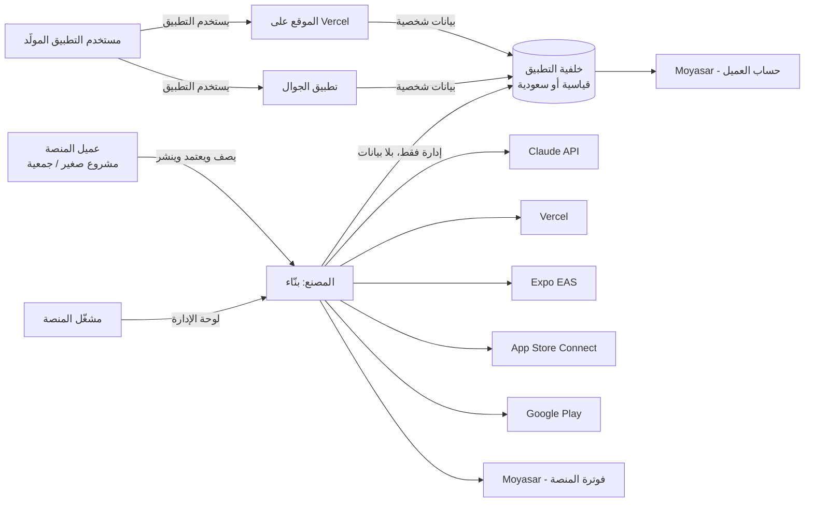
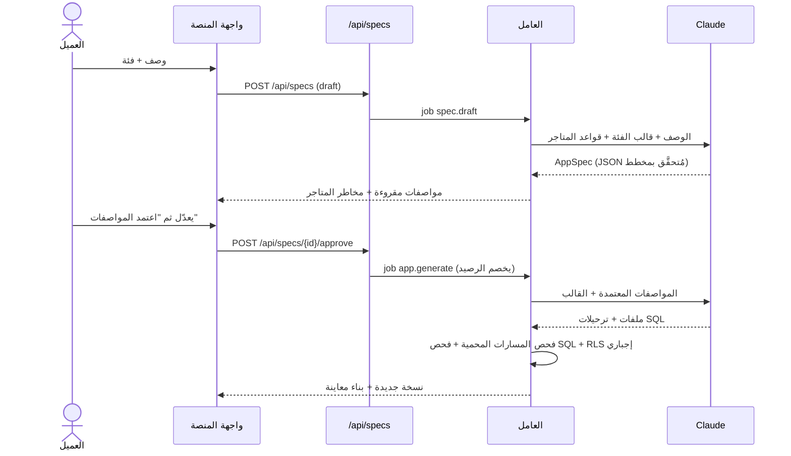
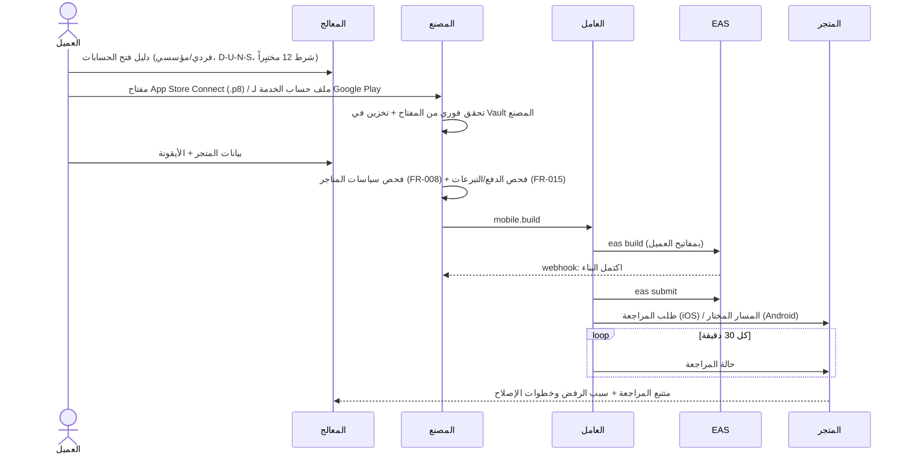
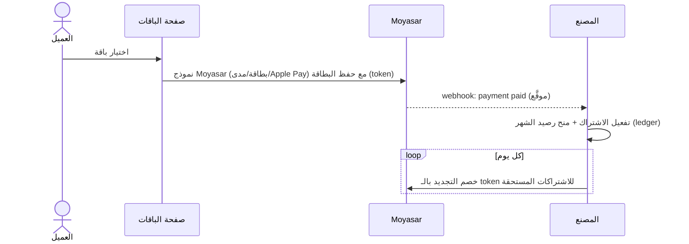

# المرحلة 2: وثيقة التصميم المعماري (الإصدار 1.0، معتمد)

> **الحالة: معتمدة من مصعب في 21 نوفمبر 2026 (محتوى الإصدار 0.2).** تنفّذ المتطلبات في [01-requirements.md](01-requirements.md) الإصدار 1.1 (يشمل طلب التغيير CR-001: الاستضافة الأرخص افتراضياً، والسعودية إضافة مدفوعة، ولا تكلفة ثابتة قبل الدفع).
> الدليل المتبع: [docs/process/02-design.md](../process/02-design.md). النموذج الأولي السابق ([architecture.md](../architecture.md)) مُدخل؛ الفروقات عنه في القسم 11.
> كل ما عليه علامة 🔎 معلومة عن مزوّد خارجي يجب التحقق منها مباشرة مع المزوّد قبل التنفيذ.

---

## 1. المبادئ الحاكمة

### 1.1 فصل "المصنع" عن "بيانات الناس"
| المنطقة | ما فيها | بيانات شخصية لمستخدمي التطبيقات؟ |
|---|---|---|
| **المصنع** (Control Plane) | المنصة، الذكاء الاصطناعي، البناء، النشر، الفوترة، لوحة الإدارة | **لا أبداً** |
| **خلفية التطبيق** (Data Plane) | قاعدة بيانات كل تطبيق، تسجيل دخول مستخدميه، ملفاتهم، مدفوعاتهم | نعم، وهي المكان الوحيد لها |

1. الذكاء الاصطناعي يرى المواصفات والكود ومخطط قاعدة البيانات فقط، ولا يقرأ أي صف من بيانات تطبيق.
2. الموقع المنشور على Vercel ملفات ثابتة بلا خادم؛ المتصفح يتصل مباشرة بخلفية التطبيق.
3. تطبيقات الجوال لا تحتوي بيانات، فقط عنوان الخلفية ومفتاحها العام.
4. المصنع يدير الخلفيات بأوامر إدارية فقط (إنشاء، ترحيل، إيقاف، حذف، إحصاءات مجمّعة).

هذا الفصل هو ما يجعل نقل تطبيق من الاستضافة القياسية إلى السعودية ممكناً دون تغيير المصنع أو الكود المولَّد.

### 1.2 وضعا الاستضافة (CR-001)
| | **القياسية** (افتراضية) | **داخل السعودية** (إضافة مدفوعة، FR-017) |
|---|---|---|
| أين | مشروع Supabase مُدار لكل تطبيق في أقرب منطقة متاحة 🔎 | مكدس Supabase مستضاف ذاتياً لدى مزوّد سحابي سعودي |
| متى يُنشأ | عند أول نشر لعميل في باقة مدفوعة | عند طلب العميل ودفعه رسوم التجهيز مقدماً |
| من يتحمل التكلفة | ضمن سعر الباقة | العميل: رسوم تجهيز + رسوم شهرية تغطي التكلفة وهامشاً |
| الجهد التشغيلي | شبه معدوم (مُدار) | أعلى: نشغّله نحن |

### 1.3 صفر تكلفة ثابتة قبل الدفع (NFR-007)
- كل مورد خاص بتطبيق (قاعدة بيانات، خلفية سعودية) يُنشأ فقط بعد دفع ناجح.
- المعاينة لا تحتاج أي قاعدة بيانات على الخادم (القسم 5.2).
- خدمات المنصة نفسها تبدأ بأدنى الباقات المسموح بها تجارياً، وتُرفع عند الحاجة (القسم 12).

## 2. مخطط السياق (C4 مستوى 1)



---

## 3. الحاويات (C4 مستوى 2)

### 3.1 المصنع
| الحاوية | التقنية | المسؤولية |
|---|---|---|
| تطبيق الويب للمنصة | Next.js 15 على Vercel | الواجهة (عربي/إنجليزي)، و API routes، و webhooks |
| قاعدة بيانات المنصة | Supabase مستضاف (أقرب منطقة) | العملاء، المشاريع، المواصفات، النسخ، النشر، الفوترة، الإدارة |
| العامل (Worker) | Node.js في حاوية دائمة 🔎 (Fly.io أو Railway أو VM) | تنفيذ المهام الطويلة من طابور `jobs`: البناء، الرفع، إدارة الخلية |
| خدمة التوليد | داخل العامل | استدعاء Claude لكتابة المواصفات ثم الكود |
| التخزين | Supabase Storage | لقطات النسخ، الأيقونات، ملفات التصدير |

### 3.2 خلفية التطبيق: الوضع القياسي (افتراضي)
| المكوّن | التقنية | المسؤولية |
|---|---|---|
| مشروع Supabase مُدار لكل تطبيق | Supabase Management API (كود النموذج الأولي يُعاد استخدامه) | قاعدة بيانات مستقلة + دخول + ملفات + دوال Edge (FR-005) |
| مؤسسة Supabase للتطبيقات | منفصلة عن مؤسسة المنصة | تُرقّى إلى باقة مدفوعة عند أول عميل ينشر 🔎 |
| الأسرار | Supabase Vault داخل مشروع التطبيق | المفتاح السري لـ Moyasar الخاص بالعميل |

### 3.3 خلفية التطبيق: الوضع السعودي (عند الطلب، FR-017)
**لا يُنشأ أي شيء منه الآن.** يُجهَّز عند أول طلب مدفوع، ويُكتب كبنية كقوالب جاهزة (Terraform + Helm) في مرحلة التنفيذ دون تشغيل.

| المكوّن | التقنية |
|---|---|
| عنقود Kubernetes صغير لدى مزوّد سعودي (ADR-002) | يستضيف خلفيات كل العملاء السعوديين؛ يبدأ بخادم أو خادمين |
| Postgres مُدار أو على العنقود | قاعدة منفصلة لكل تطبيق |
| مكدس Supabase مستضاف ذاتياً لكل تطبيق | GoTrue + PostgREST + Edge Runtime + Storage، بنفس مكتبة `supabase-js` |
| واجهة إدارة الخلية (`cell-control`) | أوامر المصنع عبر mTLS، لا تُرجع بيانات مستخدمين |
| النسخ الاحتياطي | داخل المملكة |

**تجريد مشترك:** المصنع يتعامل مع الوضعين عبر واجهة واحدة `BackendProvider` (provision, applyMigrations, setSecret, suspend, resume, destroy, exportData, stats)، ولها تطبيقان: `SupabaseHostedProvider` و`SaudiCellProvider`. الكود المولَّد لا يعرف أين تُستضاف خلفيته.

**الترحيل للسعودية:** إيقاف الكتابة مؤقتاً، `pg_dump` من المشروع القياسي، استعادة في الخلية، نقل ملفات Storage، تحديث عنوان الخلفية في التطبيق (تحديث فوري للجوال + إعادة نشر الويب)، ثم حذف المشروع القياسي بعد 7 أيام. مستخدمو التطبيق يحتفظون بحساباتهم (جدول `auth.users` يُنقل مع كلمات المرور المشفّرة).

---

## 4. نموذج البيانات

### 4.1 قاعدة بيانات المنصة (المصنع)
يُعاد استخدام مخطط النموذج الأولي مع التعديلات التالية (التفاصيل في القسم 11):

| الجدول | الحقول الأساسية | ملاحظات |
|---|---|---|
| `profiles` | id, full_name, locale, credits_balance, role (`customer`/`admin`) | الدور يُقرأ من `app_metadata` ولا يعدّله المستخدم |
| `organizations` | id, owner_id, kind (`business`/`charity`), legal_name, license_number, verification_status, verified_by | توثيق الجمعيات (FR-012c، قيد التبرعات) |
| `projects` | id, owner_id, organization_id, name, slug, category, status, current_version_id, current_spec_id | `category` من الفئات الست |
| **`app_specs`** | id, project_id, spec_number, content (jsonb), markdown, status (`draft`/`approved`/`superseded`), approved_at, approved_by | **جديد** (FR-002a/b). لا يُعدَّل بعد الاعتماد |
| `project_versions` | + spec_id | كل نسخة تشير للمواصفات التي بُنيت منها |
| `credit_transactions` | كما هو | سجل غير قابل للتعديل |
| **`plans`** | id, code, price_sar, monthly_credits, max_published_apps, features (jsonb: export, custom_domain, stores) | **جديد**، الأسعار تُحسم قبل التنفيذ |
| `subscriptions` | + plan_id, moyasar_token_id, current_period_end, status | يحل محل حقول Stripe |
| **`payments`** | id, user_id, moyasar_payment_id, amount_halalas, purpose, status | **جديد**، فواتير المنصة |
| `publisher_accounts` | platform (`ios`/`android`)، kind = `customer` فقط | Android صار حساب العميل (FR-006a) |
| `app_backends` | + hosting (`standard`/`saudi`)، provider_ref، region، api_url، anon_key، status | من النموذج الأولي، مع حقل وضع الاستضافة؛ لا أسرار فيه |
| **`hosting_requests`** | id, project_id, setup_fee_payment_id, monthly_fee_sar, status (`requested`/`paid`/`provisioning`/`migrating`/`active`) | **جديد** (FR-017) |
| `backend_migrations` | كما هو + cell_id | |
| **`app_payment_accounts`** | id, project_id, provider (`moyasar`), publishable_key, status | المفتاح السري يُرسَل مباشرة للخلية، ولا يُخزَّن في المصنع |
| **`code_exports`** | id, project_id, version_id, storage_path, expires_at | **جديد** (FR-016) |
| **`audit_log`** | id, actor_id, action, target, metadata, at | **جديد**، أفعال الإدارة والعمليات الحساسة |
| **`reports`** | id, project_id, reporter_email, reason, status | **جديد**، بلاغات المحتوى (UC-14) |
| بقية الجداول | `web_deployments`, `domains`, `mobile_apps`, `mobile_builds`, `store_submissions`, `ota_releases`, `jobs` | كما في النموذج الأولي |

**الصلاحيات:** RLS على كل جدول بنمط `owner_id = (select auth.uid())`. المسؤول (`role = admin`) يقرأ عبر دوال `security definer` تكتب في `audit_log`، لا عبر تجاوز RLS العام.

### 4.2 قاعدة بيانات كل تطبيق (في الوضعين)
- قاعدة Postgres منفصلة باسم `app_<id>`، بأدوار خاصة بها (`authenticator`, `anon`, `authenticated`) وكلمة مرور فريدة.
- مخطط `auth` خاص بها، فمستخدمو كل تطبيق معزولون تماماً عن غيره.
- الجداول يولّدها الذكاء الاصطناعي من المواصفات، وكل جدول فيه RLS إجبارياً (يرفض المحقق أي ترحيل يُنشئ جدولاً بلا RLS).
- جداول ثابتة في القالب: `profiles`، و`payments` (سجل مدفوعات Moyasar للتطبيق)، و`donations` لفئة الجمعيات.
- الاحتفاظ: حذف حساب مستخدم التطبيق يحذف بياناته خلال 30 يوماً (FR-011، PDPL).

---

## 5. مسارات العمل الرئيسية

### 5.1 من الوصف إلى المواصفات إلى التطبيق (UC-02, UC-02a — FR-002, FR-002a)

**محتوى AppSpec:** الهدف، الجمهور، الشاشات (اسم، غرض، عناصر)، الكيانات وحقولها، الأدوار والصلاحيات، الدفع (نوعه: سلع مادية عبر Moyasar، أو محتوى رقمي ← IAP على iOS)، التبرعات (متاحة فقط لجمعية موثقة ومؤهلة)، والتحقق من مخاطر المتاجر (4.2، 4.3، 5.1.1).

**التعديل (UC-03 — FR-002b):** كل طلب تعديل يمر بالمصنّف أولاً: إن كان جوهرياً (شاشة جديدة، كيان جديد، دفع) تُنشأ مواصفات جديدة ويُعرض الفرق للاعتماد؛ وإن كان شكلياً (لون، نص) يُنفَّذ مباشرة على المواصفات الحالية.

### 5.2 المعاينة ثم تجهيز الخلفية (FR-005, FR-012a/b, NFR-007)
**المعاينة (مجانية، بلا خادم):** تطبيق المعاينة يعمل بقاعدة Postgres داخل المتصفح (PGlite) 🔎 تطبّق نفس ترحيلات التطبيق وبيانات تجريبية يولّدها القالب، مع محاكاة لتسجيل الدخول. لا قاعدة على الخادم ولا تكلفة. إن ثبت في التنفيذ أن PGlite لا يكفي، البديل محوّل بيانات وهمي داخل المتصفح.
**الفحص على الخادم:** العامل يطبّق كل ترحيل على Postgres مؤقت محلي قبل قبوله (فحص الصياغة و RLS)، فالأخطاء تُكتشف قبل النشر.

**التجهيز عند أول نشر مدفوع:**
1. المصنع يتحقق من الباقة ثم ينشئ صف `app_backends` بحالة `provisioning` ومهمة `backend.provision`.
2. العامل يستدعي `BackendProvider` المناسب لوضع الاستضافة: القياسي ينشئ مشروع Supabase؛ والسعودي يستدعي `cell-control`.
3. تُرجع الخلفية `api_url` و`anon_key` فقط.
4. العامل يطبّق الترحيلات ويحدّث متغيرات البناء.

**طلب الاستضافة السعودية (FR-017):** العميل يختارها من إعدادات التطبيق ← عرض سعر (رسوم تجهيز + شهرية) ← دفع رسوم التجهيز عبر Moyasar ← `hosting_requests.status = paid` ← تنبيه للإدارة. **أول طلب على الإطلاق** يتضمن تجهيز الخلية نفسها (أيام عمل، تُذكر للعميل قبل الدفع)، والطلبات التالية تلقائية.

### 5.3 النشر على الويب والنطاقات (UC-06, UC-07 — FR-007)
كما في النموذج الأولي (Vercel REST API)، مع تغيير واحد: البناء `expo export --platform web` ينتج ملفات ثابتة فقط، ومتغير البيئة الوحيد هو عنوان خلفية التطبيق ومفتاحها العام.

### 5.4 حسابات المطورين والنشر للمتاجر (UC-08..UC-10 — FR-006, FR-006a/b, FR-008)

**Google Play على حساب العميل:** العميل ينشئ حساب خدمة في Google Cloud ويمنحه صلاحية "Release manager" في Play Console، ويرفع ملف JSON. Google لا تسمح بإنشاء التطبيق عبر الواجهة البرمجية، فالمعالج يرشده لإنشائه يدوياً أول مرة (الحالة `awaiting_store_setup` الموجودة). للحسابات الشخصية الجديدة: المعالج يشرح شرط الاختبار المغلق (12 مختبِراً لمدة 14 يوماً 🔎) ويبدأ بمسار `closed` تلقائياً.

### 5.5 التحديث الفوري (UC-11 — FR-009)
كما في النموذج الأولي: مقارنة البصمة الأصلية، ثم فحص أن التحديث لا يغيّر غرض التطبيق (Apple 2.5.2)، ثم `eas update`.

### 5.6 الفوترة (UC-12 — FR-012)

- Moyasar لا يوفر اشتراكات متكررة مدارة بالكامل حسب علمي 🔎؛ التجديد يتم بجدولة من العامل باستخدام البطاقة المحفوظة.
- فشل الخصم: 3 محاولات خلال 7 أيام، ثم تخفيض للباقة المجانية (التطبيقات المنشورة تبقى تعمل 14 يوماً إضافية مع تنبيهات، ثم تُوقف خدماتها دون حذف البيانات لمدة 90 يوماً).
- خصم الجمعيات (FR-012c): كوبون يُفعَّل تلقائياً بعد توثيق المنظمة من الإدارة.

### 5.7 الدفع داخل التطبيقات المولَّدة (UC-12a — FR-014, FR-015)
1. العميل يدخل مفتاحي Moyasar الخاصين به في المصنع.
2. المفتاح العام يُحفظ في `app_payment_accounts`؛ **المفتاح السري يُرسَل في نفس الطلب إلى خلفية التطبيق** (Vault في مشروعه) ولا يُكتب في قاعدة المصنع.
3. التطبيق يعرض نموذج Moyasar بالمفتاح العام؛ دالة Edge في خلفية التطبيق تتحقق من الدفع بالمفتاح السري وتسجّله في جدول `payments` الخاص بالتطبيق، وتستقبل webhook من Moyasar.
4. المولّد يرفض إنشاء بيع محتوى رقمي على iOS عبر Moyasar، ويقترح IAP (FR-015).
5. التبرعات: فقط لمنظمة `charity` موثقة ومؤهلة؛ وعلى iOS تتطلب اعتماد Apple للجهة ودعم Apple Pay 🔎، وإلا يصبح زر التبرع رابطاً خارجياً.

### 5.8 تصدير الكود (UC-15 — FR-016)
مهمة `code.export`: تفك لقطة النسخة، وتضيف `README.md` بالعربية والإنجليزية (كيفية التشغيل، الربط بقاعدة بيانات Supabase خاصة)، وملف ترحيلات SQL، وتحذف أي سر، وتضغطها في `code_exports` برابط موقَّع صالح 24 ساعة. **البيانات لا تمر بالمصنع**؛ تصدير بيانات المستخدمين يُنفَّذ داخل خلفية التطبيق (`exportData`) ويُسلَّم للعميل برابط مباشر منها.

### 5.9 حذف الحساب (UC-13)
- حذف حساب **مستخدم تطبيق**: دالة Edge في خلفية التطبيق (موجودة في القالب، شرط Apple 5.1.1).
- حذف حساب **عميل المنصة**: إيقاف الاشتراك، حذف خلفيات تطبيقاته، سحب تطبيقاته من النشر بعد تأكيد، ثم حذف بياناته من المصنع خلال 30 يوماً. التطبيقات المنشورة في المتاجر بحسابات العميل تبقى ملكه، ويُنبَّه بأنها ستتوقف عن العمل.

### 5.10 لوحة الإدارة (UC-14 — FR-013)
مسار `/admin` محمي بالدور. الأقسام: المستخدمون والباقات، المشاريع وحالة نشرها، البلاغات، توثيق الجمعيات، الإيرادات والتكلفة لكل تطبيق، صحة الطوابير والخلية. الإيقاف يوقف خلفية التطبيق (`suspend`) ويُسجَّل في `audit_log`. **المسؤول لا يرى بيانات مستخدمي التطبيقات**.

---

## 6. عقود الواجهات (API)

كل الاستجابات JSON. الأخطاء: `{ error: { code, message, details? } }`. التحقق بـ zod. المصادقة بكوكي جلسة Supabase.

| المسار | الطريقة | المدخلات الأساسية | المخرجات | أخطاء مميزة | المتطلب |
|---|---|---|---|---|---|
| `/api/specs` | POST | projectId, prompt, category | spec (draft) | `insufficient_credits` | FR-002a |
| `/api/specs/{id}` | PATCH | content | spec | `spec_locked` | FR-002a |
| `/api/specs/{id}/approve` | POST | — | job id | `spec_invalid` | FR-002a |
| `/api/generate` | POST | projectId, prompt | version, summary, specChange? | `insufficient_credits`, `spec_required` | FR-002, FR-002b |
| `/api/versions/{id}/restore` | POST | — | project | — | FR-003 |
| `/api/backend/migrations/{id}/approve` | POST | confirm: "DELETE_DATA" | ok | — | FR-004 |
| `/api/deploy/web` | POST | projectId, target, versionId? | deployment | `plan_required` | UC-06 |
| `/api/domains` و`/{id}` و`/{id}/verify` | GET/POST/DELETE | hostname | domains + DNS | `domain_taken`, `invalid_domain` | FR-007 |
| `/api/publisher-accounts/apple` | POST | teamId, keyId, issuerId, p8 | publisher | `apple_key_rejected` | FR-006 |
| `/api/publisher-accounts/google` | POST | serviceAccountJson, developerId | publisher | `google_key_rejected` | FR-006a |
| `/api/mobile/build-and-submit` | POST | platforms, listing | builds | `store_policy_violation`, `plan_required` | FR-008 |
| `/api/mobile/ota-push` | POST | projectId | releases | `native_rebuild_required` | FR-009 |
| `/api/billing/checkout` | POST | planCode / creditPack | Moyasar form config | — | FR-012 |
| `/api/payment-accounts/moyasar` | POST | publishableKey, secretKey | account (بلا السر) | `moyasar_key_rejected` | FR-014 |
| `/api/exports` | POST | projectId, versionId | export (رابط) | `plan_required` | FR-016 |
| `/api/hosting-requests` | POST | projectId, region: `sa` | quote + Moyasar form | `plan_required` | FR-017 |
| `/api/organizations` | POST | kind, legalName, licenseNumber, document | organization | — | FR-012c |
| `/api/admin/*` | متعدد | — | — | `forbidden` | FR-013 |
| `/api/webhooks/{vercel,eas,moyasar}` | POST | موقَّعة | 200 | `bad_signature` | — |

**واجهة إدارة الخلية السعودية** (تُبنى مع أول طلب، خاصة، mTLS):
`POST /cells/apps` (إنشاء)، `POST /cells/apps/{id}/migrations`، `POST /cells/apps/{id}/secrets/moyasar`، `POST /cells/apps/{id}/suspend|resume`، `DELETE /cells/apps/{id}`، `GET /cells/apps/{id}/stats` (أرقام مجمّعة فقط).

---

## 7. تقسيم الملفات

```
platform/
├─ apps/
│  ├─ web/                 # Next.js: الواجهة + API routes (المصنع)
│  │  └─ src/{app,components,i18n,lib,hooks}
│  ├─ worker/              # العامل: المهام الطويلة
│  └─ cell-control/        # واجهة إدارة الخلية السعودية (تُبنى عند أول طلب)
├─ packages/
│  ├─ spec/                # مخطط AppSpec (zod) + محوّل للعرض
│  ├─ generator/           # البرومبتات، المحقق، فحص SQL و RLS
│  ├─ policy/              # قواعد المتاجر والدفع والتبرعات
│  ├─ backends/            # BackendProvider: supabase-hosted و saudi-cell
│  └─ shared/              # أنواع وأخطاء مشتركة
├─ templates/expo-base/    # القالب الأساسي للتطبيقات المولَّدة
├─ infra/
│  ├─ cell/                # Helm + Terraform للخلية السعودية (جاهزة، غير منشورة)
│  └─ platform/            # إعدادات Vercel والعامل
├─ supabase/               # ترحيلات واختبارات قاعدة المصنع
└─ docs/{process,spec}
```
**قاعدة الحدود:** `cell-control` لا يستورد شيئاً من `web` أو `worker`، ويتواصل معهم عبر العقد في القسم 6 فقط.

---

## 8. نموذج التهديدات (STRIDE مختصر)

| التهديد | المثال | الضبط |
|---|---|---|
| انتحال | طلب مزوّر لواجهة الخلية أو Management API | mTLS للخلية، ورمز Management API في Vault المصنع فقط بصلاحيات المؤسسة الخاصة بالتطبيقات |
| انتحال | webhook مزوّر من Moyasar أو EAS أو Vercel | التحقق من التوقيع، ورفض المكرر (idempotency) |
| عبث | الذكاء الاصطناعي يولّد SQL يحذف بيانات أو جدولاً بلا RLS | محقق SQL، و RLS إجباري، وموافقة على الحذف (FR-004) |
| عبث | كود مولَّد يقرأ ملفات الإعداد أو الأسرار | مسارات محمية في القالب، والأسرار ليست في الكود أصلاً |
| إنكار | مسؤول يوقف تطبيقاً دون أثر | `audit_log` غير قابل للتعديل |
| كشف معلومات | تسرّب بيانات مستخدمي تطبيق لتطبيق آخر | قاعدة وأدوار ومفاتيح JWT منفصلة لكل تطبيق |
| كشف معلومات | بيانات شخصية تصل للذكاء الاصطناعي أو السجلات خارج السعودية | قاعدة المنطقتين (القسم 1)، وتنقية السجلات، واختبار آلي يفحص عدم وجود اتصال من المصنع بقواعد التطبيقات |
| كشف معلومات | تسرّب مفاتيح Apple/Google/Moyasar | Vault، لا تُرجع للمتصفح، صلاحيات أدنى، تدوير عند الطلب |
| حجب الخدمة | تطبيق واحد يستهلك موارد مشتركة | مشروع مستقل لكل تطبيق في الوضع القياسي، وحدود موارد في الخلية |
| حجب الخدمة | استنزاف رصيد التوليد | حدود طلبات لكل مستخدم، والخصم قبل التوليد |
| رفع صلاحيات | عميل يمنح نفسه دور مسؤول | الدور في `app_metadata` لا يعدّله إلا الخادم، وأعمدة محمية بمنح عمودية |

---

## 9. القرارات المعمارية (ADR)

| المعرّف | القرار | البدائل المرفوضة وسببها |
|---|---|---|
| ADR-001 | فصل المصنع عن خلفيات التطبيقات (القسم 1.1) | خادم واحد يجمع الكل: يمنع نقل التطبيق للسعودية ويعرّض البيانات للذكاء الاصطناعي |
| ADR-002 | الوضع السعودي على Kubernetes لدى مزوّد بمنطقة سعودية، **يُختار عند أول طلب** بتقييم 🔎: Google Cloud (الدمام)، Oracle Cloud (جدة/الرياض)، STC Cloud، وAWS إن أُطلقت منطقتها | الاختيار الآن: لا عميل ولا تكلفة مبررة بعد (NFR-007) |
| ADR-003 | الوضع القياسي: مشروع Supabase مُدار لكل تطبيق | قاعدة مشتركة لكل التطبيقات: أرخص لكن يخالف FR-005 ويصعّب النقل للسعودية |
| ADR-004 | واجهة `BackendProvider` واحدة للوضعين | منطق منفصل لكل وضع داخل المسارات: تكرار وأخطاء |
| ADR-005 | Expo (React Native + web export) للتطبيقات المولَّدة | Capacitor: أضعف في الأداء وتجربة الجوال الأصلية |
| ADR-006 | التجديد الشهري بجدولة ذاتية عبر بطاقات Moyasar المحفوظة | Stripe: دعم مدى وسوق السعودية أضعف |
| ADR-007 | المواصفات كائن JSON بمخطط zod، يُعرض كنص مقروء | نص حر: لا يمكن التحقق منه آلياً ولا ربطه بالكود |
| ADR-008 | العامل في حاوية دائمة صغيرة لا في دوال Vercel | المهام الطويلة (eas-cli، انتظار المراجعة) تتجاوز حدود الدوال |
| ADR-009 | مستودع واحد بمجلدات apps/packages (monorepo) | مستودعات منفصلة: يصعب مشاركة الأنواع والمخطط |
| ADR-010 | المعاينة بقاعدة داخل المتصفح (PGlite) 🔎 | قاعدة معاينة على الخادم: تكلفة ثابتة تخالف NFR-007 |

---

## 10. مصفوفة التتبع

| المتطلب | المكوّنات |
|---|---|
| FR-001 | Supabase Auth (المصنع)، `/login` |
| FR-002 | `packages/generator`، العامل، `/api/generate` |
| FR-002a/b | `app_specs`، `packages/spec`، `/api/specs*`، واجهة مراجعة المواصفات |
| FR-003 | `project_versions` (غير قابلة للتعديل)، `/api/versions/{id}/restore` |
| FR-004 | محقق SQL، `backend_migrations`، بطاقة الموافقة |
| FR-005 | `BackendProvider`، مشروع Supabase لكل تطبيق، `app_backends` |
| FR-006/006a | `publisher_accounts`، `/api/publisher-accounts/*`، العامل |
| FR-006b | المعالج: دليل الحسابات، مسار `closed` لحسابات Google الجديدة |
| FR-007 | `domains`، `/api/domains*`، Vercel API |
| FR-008 | `packages/policy`، الفحص قبل الإرسال |
| FR-009 | البصمة الأصلية، `/api/mobile/ota-push` |
| FR-010 | `src/i18n`، تخطيط RTL، اختبارات لقطات بالعربية والإنجليزية |
| FR-011 | دالة حذف الحساب في القالب (خلفية التطبيق) |
| FR-012/012a/b/c | `plans`، `subscriptions`، `payments`، `/api/billing/*`، webhook Moyasar، قاعدة المعاينة المؤقتة |
| FR-013 | `/admin`، `audit_log`، `reports` |
| FR-014 | `app_payment_accounts`، Vault خلفية التطبيق، دالة Edge للتحقق من الدفع |
| FR-015 | `packages/policy` + المولّد |
| FR-016 | `code_exports`، مهمة `code.export` |
| FR-017 | `hosting_requests`، `SaudiCellProvider`، `cell-control`، `infra/cell`، الترحيل (القسم 3.3) |
| NFR-001 | بناء المعاينة الثابتة، قياس الزمن في العامل |
| NFR-002 | RLS + اختبارات RLS، فصل قواعد التطبيقات |
| NFR-003 | Vault المصنع وVault خلفية التطبيق، منح عمودية |
| NFR-004 | القسم 1.1، إشعار الخصوصية والموافقة في القالب، اتفاقية معالجة البيانات مع Supabase، الوضع السعودي عند الطلب |
| NFR-005 | Vercel + Supabase مُدار، مراقبة وتنبيهات |
| NFR-006 | تكلفة كل تطبيق ضمن سعر باقته، القسم 12 |
| NFR-007 | التجهيز بعد الدفع فقط، المعاينة داخل المتصفح، الوضع السعودي عند الطلب |

---

## 11. الفروقات عن النموذج الأولي

| ما في النموذج الأولي | التصميم المعتمد | الأثر في التنفيذ |
|---|---|---|
| مشروع Supabase مستضاف لكل تطبيق عبر Management API | يبقى كما هو للوضع القياسي، ويُضاف الوضع السعودي | نقل `supabase-management.ts` إلى `SupabaseHostedProvider`، وتأجيل التجهيز إلى ما بعد الدفع |
| Android على حساب المنصة افتراضياً | حساب العميل دائماً | تعديل `publisher_accounts` والمسار و`build-and-submit` |
| لا مواصفات؛ التوليد من الوصف مباشرة | مواصفات معتمدة قبل التوليد | جدول ومسارات وواجهة جديدة، وتعديل `ai/generate.ts` |
| Stripe/Moyasar غير محدد | Moyasar فقط مع جدولة التجديد | جداول `plans`, `payments`، ومسارات الفوترة |
| SSR مسموح في التطبيقات المولَّدة | ملفات ثابتة فقط | قيد في القالب والمحقق |
| لا لوحة إدارة ولا تصدير ولا منظمات | موجودة | جداول ومسارات وواجهات جديدة |
| مجلد واحد | monorepo (apps/packages) | نقل الملفات دون تغيير منطقها |
| الواجهة الحالية (الخطوة 4) | تبقى أساساً، مع إضافة شاشة المواصفات والفوترة والإدارة | تعديلات لا إعادة كتابة |

---

## 12. تقدير التكلفة (تقريبي 🔎)

### 12.1 قبل أول عميل يدفع (الإطلاق)
| البند | الشهري | ملاحظة |
|---|---|---|
| Supabase للمنصة | 0 | الباقة المجانية؛ تُوقف بعد أسبوع خمول، فتُرقّى (~95 ريال) عند الإطلاق الفعلي |
| Vercel | ~75 ريال | الباقة المجانية لا تسمح بالاستخدام التجاري، فالحد الأدنى Pro |
| Expo EAS | 0 | الباقة المجانية تكفي للتجارب؛ تُرقّى مع أول عملاء |
| العامل | ~20–40 ريال | حاوية صغيرة دائمة |
| Claude | حسب الاستخدام | يُغطى من رصيد العملاء؛ تجاربنا بضعة ريالات |
| نطاق المنصة | ~5 ريال | ~50 ريال سنوياً |
| **المجموع** | **~100–120 ريال** | أقرب ما يمكن للصفر مع ترخيص تجاري صحيح |

### 12.2 مع العملاء (يغطيه الدفع)
| البند | التكلفة | يغطيها |
|---|---|---|
| مؤسسة Supabase للتطبيقات (Pro) | ~95 ريال شهرياً، تُفعَّل مع أول عميل ينشر | الاشتراكات |
| كل تطبيق منشور (وضع قياسي) | ~40 ريال شهرياً (حوسبة Micro) | سعر الباقة (NFR-006) |
| Expo EAS Production | ~375 ريال شهرياً عند تجاوز الباقة المجانية | الاشتراكات |
| الوضع السعودي: تجهيز أول مرة | خادمان + قاعدة + تخزين: ~1,000–2,000 ريال شهرياً للعنقود | رسوم تجهيز وشهرية من أول عميل يطلبها، وتُوزَّع على من يليه |

**توصية تسعير للاعتماد قبل التنفيذ:** أي باقة تشمل النشر لا تقل عن ~100 ريال شهرياً لكل تطبيق منشور، والاستضافة السعودية تُسعَّر بعرض خاص لأول عميل.

---

## 13. مخاطر جديدة من التصميم

| المعرّف | الخطر | التخفيف |
|---|---|---|
| R-09 | تشغيل الوضع السعودي ذاتياً يحتاج خبرة DevOps | قوالب جاهزة ومجرّبة على staging قبل أول عميل، وتقييم شركة دعم محلية |
| R-10 | المزوّد السعودي لا يوفر كل الخدمات المطلوبة | معايير ADR-002 وتقييم عملي عند أول طلب |
| R-11 | PGlite لا يحاكي كل سلوك الخلفية الحقيقية في المعاينة | الفحص على الخادم لكل ترحيل، واختبار النشر الأول تلقائياً |
| R-13 | الباقة المجانية لـ Supabase توقف قاعدة المنصة بعد أسبوع خمول | ترقية عند الإطلاق الفعلي، أو مهمة دورية تبقيها نشطة أثناء التطوير |

---

## 14. للاعتماد
- طُبّقت إجابات مصعب: (1) الاختيارات حسب الأفضل للمنصة، (2) الأرخص افتراضياً والسعودية عند الطلب، (3) لا تكلفة ثابتة قبل الدفع.
- لا أسئلة مفتوحة تمنع التنفيذ. الأسعار تُحسم قبل التنفيذ (المتطلبات، قسم 9).

## 15. سجل التغييرات
| الإصدار | التاريخ | التغيير |
|---|---|---|
| 1.0 | 2026-11-21 | اعتماد مصعب |
| 0.2 | 2026-11-21 | CR-001: وضعا استضافة (قياسي افتراضي، وسعودي عند الطلب)، و`BackendProvider`، ومعاينة داخل المتصفح، وتكلفة إطلاق ~100 ريال شهرياً |
| 0.1 | 2026-11-21 | مسودة أولى من المتطلبات المعتمدة 1.0 |
